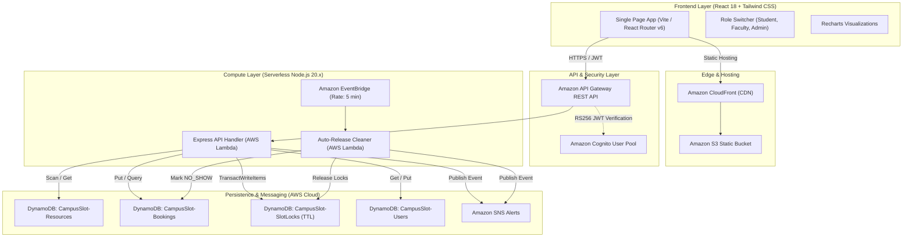

# Academic Lab Project Report & Viva Reference

## Project Title: CampusSlot – Intelligent Campus Resource Booking & Auto-Allocation System (ResourSync)

---

### Student & Course Information
- **Student Name:** Krish Kataria
- **Repository:** [https://github.com/kkrishkataria/Resourcify](https://github.com/kkrishkataria/Resourcify)
- **Course / Subject:** Cloud Computing / Advanced Full-Stack Web Development / Distributed Systems Lab
- **Technology Stack:** Pure JavaScript (Node.js, React, Tailwind CSS, Express, AWS SDK v3, DynamoDB, AWS SAM)

---

## 1. Problem Statement & Objectives
Campus facilities such as high-performance computing labs, seminar halls, quiet study suites, and recreation courts suffer from:
1. **Double Bookings & Race Conditions:** Concurrent reservation requests during peak hours lead to conflicting bookings if locks are not handled atomically at the database layer.
2. **Sub-optimal Capacity Allocation:** Students reserve large lecture auditoriums (100+ capacity) for small group study sessions (2-4 students), wasting institutional resources.
3. **Ghost Reservations (No-Shows):** Facilities are reserved but unoccupied because students fail to show up, with no automated release mechanism.
4. **Lack of Intelligent Fallbacks:** When a requested slot is occupied, traditional systems display an error without offering nearby or peer alternatives.

### Solution Objectives
- Implement **discrete 30-minute time slot locking** via **Amazon DynamoDB `TransactWriteItems`** with conditional checks (`attribute_not_exists`) for atomic conflict prevention.
- Design an **Explainable Auto-Allocation Suitability Algorithm** that scores capacity fit and equipment requirements.
- Build a **Smart Suggestions Engine** that recommends nearby time offsets and similar peer venues when conflicts occur.
- Implement an **Automated Grace-Period Check-In & No-Show Release Engine** triggered periodically by Amazon EventBridge.
- Provide a responsive SaaS dashboard with real-time telemetry, peak hours distribution, and capacity analytics.

---

## 2. System Architecture

---

## 3. Database Schema Design (Amazon DynamoDB)

| Table Name | Partition Key (PK) | Sort Key (SK) | Global Secondary Indexes (GSIs) | TTL Attribute | Description |
| :--- | :--- | :--- | :--- | :--- | :--- |
| **`CampusSlot-Resources`** | `id` (String) | — | `CategoryIndex` (PK: `category`) | — | Venue specs, building, capacity, equipment, operating hours |
| **`CampusSlot-Bookings`** | `id` (String) | — | `UserBookingsIndex` (PK: `userId`, SK: `createdAt`) `ResourceDateIndex` (PK: `resourceId`, SK: `date`) | — | Booking records, status, time windows, grace period deadlines |
| **`CampusSlot-SlotLocks`** | `lockKey` (String) | — | `ResourceDateSlotsIndex` (PK: `resourceId`, SK: `date`) | `expiresAt` | Atomic 30-min locks (`${resourceId}#${date}#${timeSlot}`) |
| **`CampusSlot-Users`** | `id` (String) | — | `EmailIndex` (PK: `email`) | — | Student, Faculty, and Admin identity profiles |

---

## 4. Key Algorithms & Mathematical Formulations

### Algorithm 1: Atomic Booking Conflict Prevention
- Let $R$ be the requested resource and $D$ be the date.
- The reservation interval $[T_{start}, T_{end}]$ is partitioned into $k$ discrete 30-minute intervals:
  $$S = \{ s_1, s_2, \dots, s_k \}, \quad \text{where } s_i = T_{start} + (i-1) \times 30\text{ min}$$
- Unique lock keys are generated:
  $$L_i = R \parallel \text{"\#"} \parallel D \parallel \text{"\#"} \parallel s_i$$
- DynamoDB executes an ACID transaction:
  $$\text{TransactWriteItems} = [ \text{Put}(L_1, \text{condition}=\text{attribute\_not\_exists}(L_1)), \dots, \text{Put}(\text{Booking}) ]$$
- **Guaranteed Invariant:** If any $L_i$ already exists, the transaction fails completely, preventing partial or double bookings.

### Algorithm 2: Suitability Scoring Formula
For candidate resource $r$ matching requested capacity $C_{req}$ and equipment requirements $E_{req}$:
$$\text{Penalty}_{capacity} = \min(45, 1.5 \times (r.capacity - C_{req}))$$
$$\text{Bonus}_{equipment} = \begin{cases} +10, & \text{if all } E_{req} \subseteq r.equipment \\ -40 \times (1 - \text{match\_ratio}), & \text{otherwise} \end{cases}$$
$$\text{Score}(r) = \max(10, 100 - \text{Penalty}_{capacity} + \text{Bonus}_{equipment})$$

---

## 5. Automated Test Cases & Verification Evidence

All 18 automated tests pass across 6 test suites using Jest:

| # | Test Suite | Test Case Description | Expected Result | Status |
| :---: | :--- | :--- | :--- | :---: |
| 1 | `conflict.test.js` | Single user booking valid 30-min window | Booking confirmed, 3 slot locks created | **PASS** |
| 2 | `conflict.test.js` | Overlapping booking attempt on occupied slot | Transaction rejected with `SLOT_CONFLICT` | **PASS** |
| 3 | `conflict.test.js` | Adjacent bookings touching boundary (e.g. 09:00-10:00 & 10:00-11:00) | Both confirmed without conflict | **PASS** |
| 4 | `conflict.test.js` | Booking requested outside operating hours | Rejected with validation error | **PASS** |
| 5 | `concurrency.test.js` | **10 concurrent users firing at the exact same millisecond for identical slot** | **Exactly 1 succeeds, 9 fail with slot conflict** | **PASS** |
| 6 | `allocation.test.js` | Capacity optimization (small room vs auditorium) | Selects optimal room, penalizes oversized hall | **PASS** |
| 7 | `allocation.test.js` | Large group request | Selects auditorium when capacity exceeds small room | **PASS** |
| 8 | `suggestions.test.js` | Resource occupied at requested time | Recommends nearby offsets & peer venue | **PASS** |
| 9 | `checkin.test.js` | Check-in verified before deadline | Status transitions to `CHECKED_IN` | **PASS** |
| 10 | `checkin.test.js` | Scheduled auto-release on expired booking | Marks `NO_SHOW`, releases slot locks | **PASS** |
| 11 | `integration.test.js`| `GET /health` | Status 200 with service UP | **PASS** |
| 12 | `integration.test.js`| `GET /api/resources` | Returns array of campus venues | **PASS** |
| 13 | `integration.test.js`| `GET /api/availability` | Returns 30-min slot calendar | **PASS** |
| 14 | `integration.test.js`| `POST /api/bookings` | Creates reservation with atomic locks | **PASS** |
| 15 | `integration.test.js`| `POST /api/allocate` | Automated constraint allocation | **PASS** |
| 16 | `integration.test.js`| `GET /api/suggestions` | Retrieves ranked alternatives | **PASS** |
| 17 | `integration.test.js`| `GET /api/admin/analytics` | Returns KPIs & peak hours for Admin | **PASS** |
| 18 | `integration.test.js`| `GET /api/admin/analytics` (RBAC) | Denies access (403) for Student role | **PASS** |

---

## 6. Viva & Oral Exam Q&A Preparation

**Q1: How does your system guarantee that two students clicking "Book" at the same second don't get the same room?**  
*Answer:* We divide time into discrete 30-minute intervals. When a user requests a booking, the backend creates a unique lock item for each slot in DynamoDB and writes them alongside the booking using `TransactWriteItems`. Every slot lock has a condition check: `attribute_not_exists(lockKey)`. Because DynamoDB transactions are atomic, linearizable, and ACID-compliant, only one request acquires the locks; all concurrent attempts fail with `TransactionCanceledException`.

**Q2: Why does your project have a local memory mode?**  
*Answer:* It uses the **Adapter Design Pattern** (`IDatabaseAdapter`). In local development, the in-memory adapter replicates DynamoDB conditional transaction semantics (`TransactWriteItems` with atomic mutex locking). This allows any examiner to test the entire system offline with zero AWS costs or credentials, while setting `DB_MODE=dynamodb` connects directly to live AWS DynamoDB.

**Q3: How does your auto-allocation algorithm prevent resource wastage?**  
*Answer:* Rather than merely picking the first available room, the system evaluates all candidate resources with a **Suitability Scoring Function**. It applies a capacity penalty of $1.5$ points per excess seat up to 45 points, ensuring that a 4-person study group is matched to a 4-8 seat study pod rather than consuming a 120-seat lecture hall.

**Q4: How are no-show reservations handled?**  
*Answer:* Each booking has an automatic 15-minute check-in grace period stored in `checkInDeadline`. In production, **Amazon EventBridge** triggers a scheduled AWS Lambda function every 5 minutes. The function identifies confirmed bookings where `checkInDeadline < now`, transitions their status to `NO_SHOW`, and atomically deletes their slot locks, immediately freeing the venue for other students.
