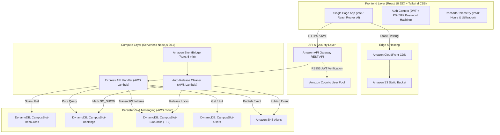

# Academic Lab Project Report & Viva Reference

## Project Title: Resourcify – Intelligent Campus Resource Booking & Auto-Allocation System
### Institution: Thapar Institute of Engineering & Technology (TIET), Patiala

---

### Student & Course Information
- **Student Name:** Krish Kataria
- **Repository:** [https://github.com/kkrishkataria/Resourcify](https://github.com/kkrishkataria/Resourcify)
- **Course / Subject:** Cloud Computing / Advanced Full-Stack Web Development / Distributed Systems Lab
- **Technology Stack:** Pure JavaScript (Node.js 20, React 18 JSX, Tailwind CSS, Express, AWS SDK v3, DynamoDB, AWS SAM)

---

## 1. Problem Statement & Objectives
At Thapar Institute of Engineering & Technology (TIET), high-demand campus facilities—such as the **NVIDIA Supercomputing Lab at COS Complex**, **Nava Nalanda Central Library (NNCL) discussion pods**, **LP Block lecture halls**, and **Indoor Badminton/Basketball courts**—experience high contention and scheduling bottlenecks:
1. **Double Bookings & Contention Races:** Simultaneous booking requests during hackathons and mid-semesters cause race conditions without ACID transactional locks.
2. **Capacity Mismatch:** Students frequently book 90-person lecture theatres (LP-108) for small 3-person project discussions, leaving limited space for large classes.
3. **Ghost Bookings (No-Shows):** Facilities are reserved but left empty with no automated attendance tracking.
4. **Lack of Intelligent Fallbacks:** Traditional portals reject conflicted requests without suggesting nearby time slots or peer rooms across campus.

### Resourcify Solution Objectives
- Implement **discrete 30-minute time slot locking** via **Amazon DynamoDB `TransactWriteItems`** with conditional checks (`attribute_not_exists`) for atomic conflict prevention.
- Design an **Explainable Auto-Allocation Suitability Algorithm** that optimizes capacity fit and equipment requirements.
- Build a **Smart Suggestions Engine** that suggests nearby time offsets and similar peer venues at Thapar Institute.
- Implement an **Automated Grace-Period Check-In & No-Show Release Engine** triggered periodically by Amazon EventBridge.
- Provide real authentication with **salted PBKDF2 password hashing** and signed **JSON Web Tokens (JWT)** for role-based authorization (Student, Faculty, Admin).

---

## 2. System Architecture

---

## 3. Real Authentication & Default Accounts

| Role | Name | Email | Password | Department |
| :--- | :--- | :--- | :--- | :--- |
| **Student** | Aarav Sharma | `student@thapar.edu` | `Thapar@2026` | Computer Science & Engineering (CSED) |
| **Student** | Riya Kapoor | `riya.kapoor@thapar.edu` | `Thapar@2026` | Electronics & Communication (ECED) |
| **Faculty** | Dr. Rajesh K. Bawa | `faculty@thapar.edu` | `Thapar@2026` | Computer Science & Engineering (CSED) |
| **Admin** | TIET Central Estate Office | `admin@thapar.edu` | `Thapar@2026` | Administration Directorate |

*Password Hashing:* Passwords are protected using `crypto.pbkdf2Sync` with 10,000 iterations, 64-byte key length, and SHA-512 over cryptographically random 16-byte salts. Passwords are never stored in plaintext.

---

## 4. Database Schema Design (Amazon DynamoDB)

| Table Name | Partition Key (PK) | Sort Key (SK) | Global Secondary Indexes (GSIs) | TTL Attribute | Description |
| :--- | :--- | :--- | :--- | :--- | :--- |
| **`CampusSlot-Resources`** | `id` (String) | — | `CategoryIndex` (PK: `category`) | — | Thapar venue specs, building, capacity, equipment, operating hours |
| **`CampusSlot-Bookings`** | `id` (String) | — | `UserBookingsIndex` (PK: `userId`, SK: `createdAt`) `ResourceDateIndex` (PK: `resourceId`, SK: `date`) | — | Reservation records, status, time windows, grace period deadlines |
| **`CampusSlot-SlotLocks`** | `lockKey` (String) | — | `ResourceDateSlotsIndex` (PK: `resourceId`, SK: `date`) | `expiresAt` | Atomic 30-min locks (`${resourceId}#${date}#${timeSlot}`) |
| **`CampusSlot-Users`** | `id` (String) | — | `EmailIndex` (PK: `email`) | — | Student, Faculty, and Admin identity profiles with password hashes |

---

## 5. Automated Test Cases & Verification Evidence

All 20 automated tests pass across 6 test suites using Jest:

| # | Test Suite | Test Case Description | Expected Result | Status |
| :---: | :--- | :--- | :--- | :---: |
| 1 | `integration.test.js`| `POST /api/auth/login` | Validates credentials & returns signed JWT | **PASS** |
| 2 | `integration.test.js`| `POST /api/auth/register` | Registers new Thapar student & hashes password | **PASS** |
| 3 | `conflict.test.js` | Single user booking valid 30-min window | Booking confirmed, 3 slot locks created | **PASS** |
| 4 | `conflict.test.js` | Overlapping booking attempt on occupied slot | Transaction rejected with `SLOT_CONFLICT` | **PASS** |
| 5 | `conflict.test.js` | Adjacent bookings touching boundary (09:00-10:00 & 10:00-11:00) | Both confirmed without conflict | **PASS** |
| 6 | `conflict.test.js` | Booking requested outside operating hours | Rejected with validation error | **PASS** |
| 7 | `concurrency.test.js` | **10 concurrent users firing at the exact same millisecond for identical slot** | **Exactly 1 succeeds, 9 fail with slot conflict** | **PASS** |
| 8 | `allocation.test.js` | Capacity optimization (small room vs auditorium) | Selects optimal room, penalizes oversized hall | **PASS** |
| 9 | `allocation.test.js` | Large group request | Selects auditorium when capacity exceeds small room | **PASS** |
| 10 | `suggestions.test.js` | Resource occupied at requested time | Recommends nearby offsets & peer venue | **PASS** |
| 11 | `checkin.test.js` | Check-in verified before deadline | Status transitions to `CHECKED_IN` | **PASS** |
| 12 | `checkin.test.js` | Scheduled auto-release on expired booking | Marks `NO_SHOW`, releases slot locks | **PASS** |
| 13 | `integration.test.js`| `GET /health` | Status 200 with service UP | **PASS** |
| 14 | `integration.test.js`| `GET /api/resources` | Returns array of Thapar campus venues | **PASS** |
| 15 | `integration.test.js`| `GET /api/availability` | Returns 30-min slot calendar | **PASS** |
| 16 | `integration.test.js`| `POST /api/bookings` | Creates reservation with atomic locks | **PASS** |
| 17 | `integration.test.js`| `POST /api/allocate` | Automated constraint allocation | **PASS** |
| 18 | `integration.test.js`| `GET /api/suggestions` | Retrieves ranked alternatives | **PASS** |
| 19 | `integration.test.js`| `GET /api/admin/analytics` | Returns KPIs & peak hours for Admin | **PASS** |
| 20 | `integration.test.js`| `GET /api/admin/analytics` (RBAC) | Denies access (403) for Student role | **PASS** |

---

## 6. Viva / Examination Q&A Cheat Sheet

**Q1: How does your system guarantee that two students clicking "Book" at the same second don't get the same room?**  
*Answer:* We divide operating hours into discrete 30-minute intervals. The reservation engine bundles the booking item and all slot lock items into a single DynamoDB `TransactWriteItems` call with `attribute_not_exists(lockKey)`. Because DynamoDB transactions are atomic, linearizable, and ACID-compliant, only one request acquires the locks; all concurrent attempts fail with `TransactionCanceledException`.

**Q2: How does the login authentication work in Resourcify?**  
*Answer:* Resourcify implements a dual authentication architecture. Passwords are encrypted using salted PBKDF2 hashing with SHA-512. On successful credential verification, the server generates a signed JSON Web Token (JWT) containing user ID, role (Student, Faculty, Admin), and department. In production, this integrates directly with Amazon Cognito User Pools.

**Q3: How does the auto-allocation algorithm choose between facilities?**  
*Answer:* It calculates a Suitability Score:
$$\text{Score} = 100 - \min(45, 1.5 \times (\text{Capacity} - \text{Requested})) + \text{Bonus}_{equipment}$$
This formula penalizes oversized venues, ensuring that a 4-person study group is matched to a Nava Nalanda Central Library discussion pod rather than wasting the 90-seat LP-108 lecture hall.

**Q4: What happens if a student books a lab but doesn't show up?**  
*Answer:* Each booking has a 15-minute check-in grace period stored in `checkInDeadline`. In production, an Amazon EventBridge scheduled rule triggers an AWS Lambda function every 5 minutes. The function identifies confirmed bookings where `checkInDeadline < now`, marks them as `NO_SHOW`, and atomically deletes their DynamoDB slot locks, making the room immediately available to other students.
