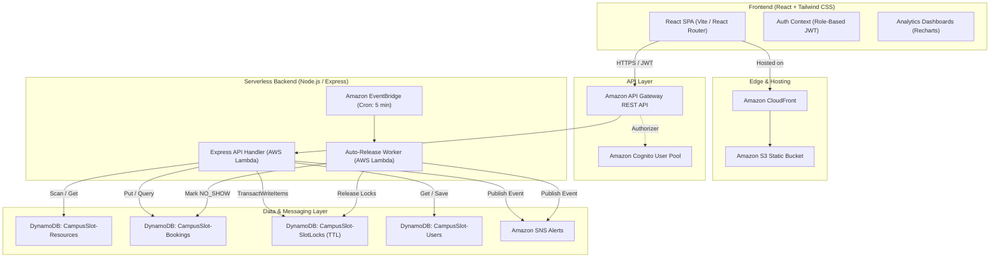

# CampusSlot – Intelligent Campus Resource Booking & Auto-Allocation System

> **CampusSlot (ResourSync)** is a production-quality, cloud-native resource scheduling and auto-allocation platform designed for modern academic institutions. It enables students, faculty members, and campus administrators to reserve and manage labs, lecture auditoriums, study suites, and sports courts with mathematical conflict prevention and explainable intelligent allocation.

---

## 🏛️ System Architecture

CampusSlot is engineered strictly in **JavaScript (ES6+)** with a decoupled client-server architecture built for deployment on Amazon Web Services (AWS) using serverless paradigms.



---

## 🚀 Key Features

### 1. Atomic Booking Conflict Prevention (30-Minute Quantum Locks)
- Standardizes all facility availability into **discrete 30-minute time intervals** (e.g. `09:00`, `09:30`, `10:00`).
- Every reserved slot is acquired as a unique atomic lock in DynamoDB with key:  
  `LOCK#${resourceId}#${date}#${timeSlot}`
- The booking creation and all required slot locks are bundled inside an **ACID `TransactWriteItems` transaction**.
- Every slot lock has a strict conditional check: `attribute_not_exists(lockKey)`.
- If two or more users attempt to book overlapping slots simultaneously, DynamoDB aborts the transaction for all but one winner with `TransactionCanceledException`. Zero double bookings are mathematically possible.

### 2. Intelligent Resource Auto-Allocation
- Accepts high-level constraints: Category, minimum capacity, duration (30-min multiples), date, preferred start time, and required equipment.
- Evaluates candidate resources against constraints, operating hours, and active status.
- **Suitability Scoring Engine**:
  $$\text{Score} = 100 - \min(45, 1.5 \times (\text{Capacity} - \text{Requested})) + \text{EquipmentBonus}$$
  Prevents wasteful allocation (e.g., allocating a 120-person auditorium for a 2-person study group).
- Iteratively tests availability for top-ranked candidates. If a candidate is contested during peak concurrency, the engine automatically attempts atomic reservation on the next best candidate.

### 3. Smart Alternatives Recommender
- When a requested slot or resource is contested or occupied, CampusSlot immediately analyzes campus availability:
  - **Nearby Time Offsets**: Checks $-120\text{m}, -60\text{m}, -30\text{m}, +30\text{m}, +60\text{m}, +120\text{m}$ for the same venue.
  - **Peer Facilities**: Searches venues in the same category and building with suitable capacity at the requested time.
- Ranks suggestions by a composite suitability and time proximity metric, enabling 1-click alternative reservation.

### 4. Check-In & Automated No-Show Release
- Implements a configurable **15-minute check-in grace period** from session start time.
- Users verify check-in via web or QR interface.
- Background scheduled worker (triggered every 5 minutes by Amazon EventBridge) detects unattended reservations where `checkInDeadline < now`.
- Unclaimed reservations are atomically transitioned to `NO_SHOW`, and their slot locks are deleted from DynamoDB, freeing valuable campus space for other students.

### 5. Executive Admin Telemetry & Analytics
- Live KPIs: Total reservations, currently held DynamoDB slot locks, cancellation rates, and no-show rates.
- Peak booking hours distribution histogram ($08:00$ to $22:00$).
- Category demand breakdown and top-utilized vs underutilized facility tables.
- Provisioning management: Add new venues, update equipment specs, and toggle maintenance modes.

---

## 🗄️ DynamoDB Database Schema

### 1. `CampusSlot-Resources`
| Attribute | Type | Description |
| :--- | :--- | :--- |
| `id` (Partition Key) | String | Unique resource identifier (e.g. `res-lab-01`) |
| `name` | String | Venue name (e.g. `Turing AI & GPU Computing Lab`) |
| `category` | String | `COMPUTER_LAB`, `SEMINAR_ROOM`, `STUDY_ROOM`, `SPORTS_COURT`, `CONFERENCE_HALL` |
| `building` | String | Campus facility complex |
| `floor` | Number | Floor level |
| `roomNumber` | String | Room designation |
| `capacity` | Number | Maximum seated capacity |
| `equipment` | List[String] | Amenities (`GPUs`, `Projector`, `Sound System`, `Whiteboard`) |
| `status` | String | `ACTIVE`, `MAINTENANCE`, `DISABLED` |
| `operatingHours` | Map | `{ start: "08:00", end: "22:00" }` |
| `minBookingDuration` | Number | Minimum allowed duration in minutes (e.g. 30) |
| `maxBookingDuration` | Number | Maximum allowed duration in minutes (e.g. 240) |
| **GSI: CategoryIndex** | GSI | Partition Key: `category` |

### 2. `CampusSlot-Bookings`
| Attribute | Type | Description |
| :--- | :--- | :--- |
| `id` (Partition Key) | String | Unique reservation ID (`book-<uuid>`) |
| `resourceId` | String | Foreign key to `CampusSlot-Resources` |
| `resourceName` | String | Denormalized facility title for fast display |
| `userId` | String | Booking owner ID |
| `userRole` | String | `STUDENT`, `FACULTY`, `ADMIN` |
| `date` | String | ISO Date (`YYYY-MM-DD`) |
| `startTime` | String | Start time formatted as `HH:MM` |
| `endTime` | String | End time formatted as `HH:MM` |
| `slotKeys` | List[String] | Array of acquired lock keys (`res-1#2026-11-25#09:00`) |
| `purpose` | String | Academic justification |
| `attendeesCount` | Number | Estimated audience size |
| `status` | String | `CONFIRMED`, `CHECKED_IN`, `CANCELLED`, `NO_SHOW`, `COMPLETED` |
| `checkInDeadline` | String | ISO 8601 timestamp for grace period expiration |
| `checkedInAt` | String | Timestamp when check-in was confirmed |
| **GSI: UserBookingsIndex** | GSI | PK: `userId`, SK: `createdAt` |
| **GSI: ResourceDateIndex** | GSI | PK: `resourceId`, SK: `date` |

### 3. `CampusSlot-SlotLocks`
| Attribute | Type | Description |
| :--- | :--- | :--- |
| `lockKey` (Partition Key) | String | Composite key: `${resourceId}#${date}#${timeSlot}` |
| `bookingId` | String | ID of the holding reservation |
| `resourceId` | String | Resource ID |
| `date` | String | Date string |
| `timeSlot` | String | 30-minute interval label (e.g. `09:30`) |
| `userId` | String | Holding user ID |
| `expiresAt` | Number | TTL epoch timestamp for automatic AWS DynamoDB eviction |

---

## 🛠️ Technology Stack

Strictly compliant with pure **JavaScript (ES6+)** standards:
- **Frontend**: React (JSX), Tailwind CSS, React Router v6, Axios, Recharts, Lucide React, Vite.
- **Backend**: Node.js (v20+), Express.js, AWS SDK for JavaScript v3 (`@aws-sdk/client-dynamodb`, `@aws-sdk/lib-dynamodb`, `@aws-sdk/client-sns`).
- **Authentication**: Amazon Cognito JWT verification with seamless local mock fallback.
- **Infrastructure**: AWS Serverless Application Model (SAM) `template.yaml`.
- **Testing**: Jest with Node.js ESM test runner (`supertest`).

---

## 📡 REST API Reference

| Method | Endpoint | Description | Auth Required |
| :--- | :--- | :--- | :--- |
| `GET` | `/health` | Service health status check | Public |
| `POST` | `/api/auth/login` | Mock/demo credential login | Public |
| `GET` | `/api/auth/me` | Fetch active user identity | User |
| `GET` | `/api/resources` | List campus venues with filter queries | User |
| `GET` | `/api/resources/:id` | Fetch specific venue details | User |
| `POST` | `/api/resources` | Provision a new campus resource | Admin |
| `PUT` | `/api/resources/:id` | Update specifications or maintenance mode | Admin |
| `DELETE` | `/api/resources/:id` | Delete a campus resource | Admin |
| `GET` | `/api/availability` | 30-min slot calendar for a resource & date | User |
| `GET` | `/api/bookings` | List active user's bookings (or all for Admin) | User |
| `POST` | `/api/bookings` | Create reservation with atomic DynamoDB locks | User |
| `GET` | `/api/bookings/:id` | Retrieve reservation details | Owner / Admin |
| `DELETE` | `/api/bookings/:id` | Cancel reservation and release slot locks | Owner / Admin |
| `POST` | `/api/bookings/:id/checkin` | Verify check-in before grace period deadline | Owner / Admin |
| `POST` | `/api/allocate` | Automated constraint-based resource allocation | User |
| `GET` | `/api/suggestions` | Retrieve ranked smart alternatives | User |
| `GET` | `/api/admin/analytics` | Telemetry KPIs, peak hours & utilization | Admin |
| `POST` | `/api/jobs/auto-release` | Trigger EventBridge no-show cleaner job | Admin / Cron |

---

## 💻 Local Quickstart

### Prerequisites
- Node.js 18+ or 20+
- npm 9+

### 1. Install Dependencies
```bash
npm --prefix backend install
npm --prefix frontend install
```

### 2. Run Test Suites
Verify all 18 automated unit and integration tests:
```bash
npm --prefix backend test
```
Tests include:
- `conflict.test.js` – Atomic slot lock acquisition and overlapping request rejection
- `concurrency.test.js` – 10 simultaneous parallel requests competing for the exact same millisecond slot
- `allocation.test.js` – Suitability scoring and capacity match penalties
- `suggestions.test.js` – Offsets and peer category alternative ranking
- `checkin.test.js` – Check-in window validation and auto-release cleanup
- `integration.test.js` – End-to-end REST API endpoint validation

### 3. Start Local Development
Start the full-stack system concurrently:
```bash
# Terminal 1: Start Backend (Port 5001)
npm run dev:backend

# Terminal 2: Start Frontend (Port 5173)
npm run dev:frontend
```
- Open your browser at: `http://localhost:5173`
- The application automatically pre-seeds realistic campus venues, users, and initial bookings.
- Use the one-click **Role Switcher** in the navbar to test as **Student**, **Faculty**, or **Admin** instantly.

---

## ☁️ AWS Cloud Deployment (Production)

### 1. Build Serverless Infrastructure
```bash
cd infrastructure
sam build
```

### 2. Deploy Guided Stack
```bash
sam deploy --guided
```
SAM will provision:
- DynamoDB tables with on-demand capacity and TTL enabled
- Amazon Cognito User Pool with custom role attributes
- API Gateway REST API with CORS and proxy integration
- Node.js 20.x Lambda API handler and scheduled EventBridge Lambda
- Amazon SNS topic for real-time notifications
- S3 static website bucket & CloudFront CDN distribution

### 3. Deploy Frontend to S3 & CloudFront
```bash
cd ../frontend
npm run build
aws s3 sync dist/ s3://<Your-Frontend-Bucket-Name> --delete
aws cloudfront create-invalidation --distribution-id <Your-Distribution-Id> --paths "/*"
```
