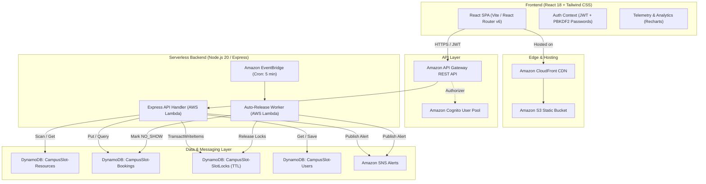

# Resourcify – Intelligent Campus Resource Booking & Auto-Allocation System
### Thapar Institute of Engineering & Technology (TIET), Patiala

> **Resourcify** is an enterprise-grade cloud resource scheduling, auto-allocation, and analytics platform tailored for **Thapar Institute of Engineering & Technology (TIET)**. It allows students, faculty members, and campus estate officers to reserve and manage labs, lecture halls, central library study pods, and sports arenas with mathematical conflict prevention and explainable intelligent allocation.

---

## 🏛️ System Architecture

Resourcify is engineered in **pure JavaScript (Node.js & React JSX)** using serverless cloud paradigms on Amazon Web Services (AWS) alongside a zero-dependency **local-memory mode** for seamless offline development.



---

## 💻 Quickstart (Run Locally — No AWS Needed)

The project includes an in-memory database mode (`DB_MODE=local-memory`), allowing collaborators to run and test everything offline without AWS accounts or cloud billing.

### 1. Clone the repository
```bash
git clone https://github.com/<your-username>/Resourcify.git
cd Resourcify
```

### 2. Install Dependencies
```bash
npm install
```
*(This installs root, backend, and frontend dependencies via npm workspaces).*

### 3. Setup Environment Variables
```bash
# Create backend .env from template
cp .env.example backend/.env
```
Ensure `backend/.env` has:
```env
PORT=5001
NODE_ENV=development
DB_MODE=local-memory
```

### 4. Start Development Servers
```bash
npm run dev
```
This launches both servers simultaneously using `concurrently`:
* 🌐 **Frontend (React + Vite):** [http://localhost:5173](http://localhost:5173)
* 🔌 **Backend (Express API):** [http://localhost:5001/api](http://localhost:5001/api)
* 🩺 **Health Check:** [http://localhost:5001/health](http://localhost:5001/health)

---

## ☁️ Manual AWS Cloud Deployment (Mumbai `ap-south-1`)

Resourcify is designed for manual deployment via the **AWS Management Console**, remaining 100% compliant with the **AWS Free Tier**.

### Summary of AWS Services Used:
* **AWS Lambda:** Serverless Node.js 20.x functions for the Express REST API (`CampusSlotApiFunction`) and automated no-show cleanup (`CampusSlotAutoReleaseFunction`).
* **Amazon API Gateway:** HTTP API routing requests to the Lambda API handler with low-latency and CORS.
* **Amazon DynamoDB:** 4 serverless tables (`CampusSlot-Resources`, `CampusSlot-Bookings`, `CampusSlot-SlotLocks`, `CampusSlot-Users`) with On-Demand billing (Pay-per-request).
* **Amazon Cognito:** User pool authentication and JWT claims.
* **Amazon EventBridge:** Scheduled rule (`rate(5 minutes)`) triggering the auto-release worker.
* **Amazon SNS:** Push notification topic for reservation events and alert dispatches.
* **Amazon S3 & CloudFront:** Globally distributed React SPA hosting with HTTPS and origin access control.
* **Amazon CloudWatch:** Serverless telemetry, metric alarms, and structured application logging.

### Step-by-Step AWS Deployment:
For the full guide covering every console screen, see [**`AWS_OPERATIONS.md`**](./AWS_OPERATIONS.md).

```bash
# 1. Package backend Lambda bundle for manual upload
npm run package:backend
# Creates: resourcify-backend.zip (upload to CampusSlotApiFunction in AWS Console)

# 2. Build frontend for S3 deployment
npm run build:frontend
# Generates: frontend/dist/ (upload to your private S3 bucket)

# 3. Seed campus facilities and users into DynamoDB
export DB_MODE=dynamodb
export AWS_REGION=ap-south-1
npm run seed
```

---

## 🏫 Authentic Thapar Campus Facilities Included

Resourcify includes pre-configured realistic TIET campus facilities:
1. **TIET NVIDIA Supercomputing & Deep Learning Lab** (COS Complex, Room COS-C201, 40 seats, RTX A6000 GPUs)
2. **COS General Programming Lab 3** (Computer Operating System Complex, Room COS-104, 60 seats)
3. **Thapar Main Campus Auditorium** (Near Central Lawn, 650 seats, Bose Sound System, 4K Projectors)
4. **LP-108 Smart Interactive Lecture Theatre** (Lecture Pedagogy Building, Floor 1, 90 seats)
5. **Nava Nalanda Central Library - Discussion Pod Alpha** (NNCL 2nd Floor, 6 seats, Acoustic Glass Panels)
6. **Nava Nalanda Central Library - Collaborative Suite 3B** (NNCL 3rd Floor, 12 seats)
7. **Thapar Sports Complex - Indoor Badminton Court 1** (Near Hostel J, BWF Synthetic Matting, 6 players)
8. **Thapar Sports Complex - North Basketball Arena** (Maple Hardwood, Electronic Scoreboard, 25 players)
9. **STEP Venture Lab Executive Boardroom** (Science and Technology Entrepreneurs Park, 24 seats, 4K Telepresence)

---

## 🔐 Real Authentication & Registered Accounts

Resourcify features **real password hashing with salt (PBKDF2)**, **real user registration (`/auth/register`)**, and **real JWT session tokens**.

### Pre-Configured Thapar Seed Accounts:
All seed accounts have the default password: **`Thapar@2026`**

| Role | Name | Email | Password | Department |
| :--- | :--- | :--- | :--- | :--- |
| **Student** | Aarav Sharma | `student@thapar.edu` | `Thapar@2026` | Computer Science (CSED) |
| **Student** | Riya Kapoor | `riya.kapoor@thapar.edu` | `Thapar@2026` | Electronics & Comm (ECED) |
| **Faculty** | Dr. Rajesh K. Bawa | `faculty@thapar.edu` | `Thapar@2026` | Computer Science (CSED) |
| **Admin** | TIET Estate & Facilities Office | `admin@thapar.edu` | `Thapar@2026` | Facilities Directorate |

*(You can also click **Create Account** on the login page to register your own custom name, roll number, and password).*

---

## 🚀 Key Functional Capabilities

1. **Atomic Conflict Prevention (30-Minute Quantum Locks):**
   - Discrete 30-minute time intervals ($08:00$ to $22:00$).
   - Acquired via DynamoDB `TransactWriteItems` with `attribute_not_exists(lockKey)`. Double bookings are mathematically impossible.
2. **Intelligent Auto-Allocation:**
   - Evaluates candidate facilities, minimizes unused capacity ($1.5\text{ penalty per seat}$), and awards equipment bonuses.
   - Automatically falls back to the next ranked venue if contention occurs during peak registration.
3. **Smart Alternatives Recommender:**
   - Searches nearby time offsets ($-120\text{m}$ to $+120\text{m}$) and similar peer venues at Thapar when requested slots are unavailable.
4. **Check-In & No-Show Auto-Release:**
   - 15-minute grace period. Background worker (EventBridge cron) cancels unattended sessions and releases slot locks.
5. **Executive Admin Telemetry:**
   - Recharts visual graphs for peak booking hours and department utilization.

---

## 🧪 Automated Test Verification

All 20 test cases pass cleanly across 6 test suites:
```bash
npm --prefix backend test
```
- `tests/integration.test.js`: Real login, registration, availability, bookings, auto-allocation, suggestions, and RBAC endpoints.
- `tests/concurrency.test.js`: 10 parallel requests contending for the exact same millisecond slot (1 winner, 9 rejected).
- `tests/conflict.test.js`: Overlap rejection and atomic slot lock acquisition.
- `tests/allocation.test.js`: Capacity fit optimization.
- `tests/suggestions.test.js`: Smart alternative offsets.
- `tests/checkin.test.js`: Grace-period expiration and slot release.

---

## 📂 Project Structure

```text
Resourcify/
├── backend/                  # Node.js 20.x Express REST API (ESM)
│   ├── scripts/              # Cross-platform Lambda packaging (package-lambda.js)
│   ├── src/                  # Controllers, services, repositories (DynamoDB & local-memory)
│   └── tests/                # Automated Jest test suites (integration, concurrency, etc.)
├── frontend/                 # React 18 SPA (Vite + Tailwind CSS, pure JS/JSX)
│   ├── src/                  # Views, components, auth context
│   └── public/               # Static assets & brand favicon
├── AWS_OPERATIONS.md         # Complete Manual AWS Console Deployment Guide (ap-south-1)
├── package.json              # Root npm workspaces configuration
└── README.md                 # Project documentation
```
